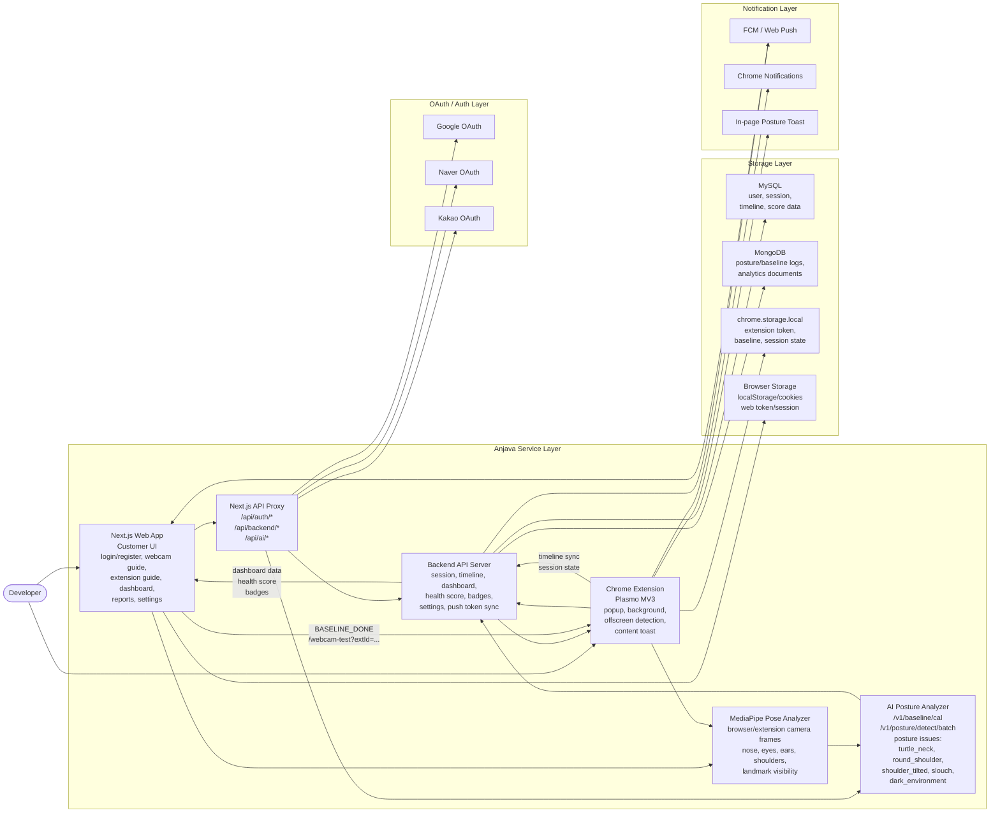

# Anjava Service Architecture

## Main Flows

1. User signs up or logs in through the Next.js web app.
2. OAuth login is routed through Next.js auth/proxy routes and external OAuth providers.
3. The web app guides the user through webcam setup, baseline measurement, extension installation, and dashboard usage.
4. The extension stores its own token and baseline state in `chrome.storage.local`.
5. Camera frames are converted into MediaPipe posture frames with face/shoulder landmarks and visibility values.
6. Baseline calibration uses `/v1/baseline/cal`; operational posture detection uses `/v1/posture/detect/batch`.
7. Detection results are synced to backend timeline/session APIs and surfaced through dashboard, Chrome notification, and page toast flows.
8. Dashboard and report screens fetch session, timeline, health score, warning counts, badges, and settings data from backend APIs.

